  

  
  
  
  

## About Me

Senior Full Stack Engineer with **8+ years** of experience building scalable web applications across **React, Next.js, Angular, Vue 3, Node.js (Express, NestJS), MongoDB, PostgreSQL, and AWS**, including **3+ years** of applied AI/ML work spanning retrieval-augmented generation (RAG), tool-calling agents, prompt/model evaluation harnesses, PII redaction guardrails, and cost-efficient inference.

  

> **Portfolio Note:** My showcase codebase lives in a **private** portfolio repository (`anflux94/resume-portfolio`). All projects are **resume-inspired portfolio demos** built with original source code and **100% synthetic sample data**, and their `2018–2026` commit history represents a **reconstructed development timeline**.

## Selected Portfolio Projects *(Private Repository)*

| Project | Stack | What It Demonstrates |
|---|---|---|
| **Hybrid RAG Answer Engine & Eval Suite** | Next.js, React, TypeScript, Express, LangChain.js, OpenAI SDK, Atlas Vector Search, BullMQ, Redis, Vitest | Pre-model PII redaction with allowlists, hybrid BM25 + vector retrieval and reranking, prompt caching + complexity routing (`gpt-4o-mini` / `gpt-4o`), and a **400-case Vitest evaluation harness** |
| **Tool-Calling Agent & Tenant Control Plane** | NestJS 11, Zod, BullMQ, OpenTelemetry, tRPC 11, Drizzle ORM, SST, EventBridge, Terraform, ECS Fargate | Multi-step Zod-validated tool planning, per-tenant sliding-window rate limits & token accounting, OpenTelemetry span tracing, and zero-downtime 40+ tenant isolation migration |
| **Logistics Ops Console & Warehouse Suite** | Angular 19+ (Standalone & Signals), NgRx, RxJS, Vue 3, Pinia, Express, MongoDB, Redis, OpenAI, Cypress | Reporting aggregations + Redis cache-aside, leak-free RxJS composition, normalized NgRx state, Vue 3 + Pinia dashboard, BOL classifier, and Angular 19+ signals/control-flow modernization |
| **HIPAA-Style Patient Intake & Audit Module** | TypeScript, Express, AES-256-GCM, SHA-256 Audit Chain, RBAC, React, Zod | Field-level authenticated encryption for sensitive fields, tamper-evident hash-chained audit logs, and least-privilege role enforcement |
| **MERN Real-Time Commerce & Billing** | Express, Mongoose, React, Redux, JWT/RBAC, Stripe Webhooks, AWS S3 SDK, Socket.IO, Postman | Compound-indexed Mongoose schemas, HMAC webhook signature verification, S3 presigned uploads, and leak-tested Socket.IO notifications |

## Tech Stack

**Front-End**  

**Back-End & Applied AI**  

**Data, Cloud & Testing**  

